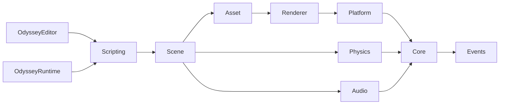

# Odyssey Architecture

This document records how Odyssey is built and why. It is the reference for design decisions; when a decision
changes, update this file in the same change. Conventions for writing code live in `AGENTS.md`; the build plan and
status live in `docs/Roadmap.md`. Sections marked *(planned)* describe the agreed design for code not written yet.

## 1. Goals

- **Simple and straightforward.** One obvious way to do each thing. Few concepts, each fully finished.
- **Production grade.** Stable on Windows, macOS and Linux (Ubuntu 24+), tested at every layer, shippable games.
- **Fully agent-operable.** An AI agent can create a complete game (eg. Tetris) without human intervention: every
  asset is text or a standard file format, and every editor operation is available headlessly with feedback
  (logs, validation errors, screenshots).
- **Modern rendering** at a sensible scope: glTF PBR, image-based lighting from HDRIs, soft shadows, good SSAO,
  HDR with tonemapping.

Non-goals (for now): consoles and mobile, multiplayer networking, visual scripting, cross-compiling exports.

## 2. Targets and modules

| Target | Kind | Contents |
|---|---|---|
| `Odyssey` | static library | The engine: everything a shipped game needs. No editor code. |
| `OdysseyEditor` | executable | Editor UI, gizmos, undo/redo, asset import UI, project management, agent server, exporter. Also runs headless. *(planned)* |
| `OdysseyRuntime` | executable | Game player. Loads an exported game and runs its start scene. Built in Dist for shipping. *(planned)* |
| `OdysseyTests` | executable | doctest unit and integration tests, plus headless GPU tests. |

The editor is a separate executable rather than an editor mode compiled into the runtime. That keeps editor code
and editor-only dependencies (ImGuizmo, the agent server, the exporter) physically out of shipped games, with no
`#ifdef` maze in the engine.

Engine modules and their allowed dependencies:



Arrows point from a module to what it may include. Nothing points back up. In particular `Renderer` knows nothing
about `Scene`: the scene builds a render list (meshes, materials, lights, camera, environment) and submits it.

## 3. Core (implemented, Phase 0)

| Type | Responsibility |
|---|---|
| `Base.h` | Platform and configuration detection, `OD_DEBUGBREAK`, `OD_BIT`, `OD_BIND_EVENT_FN`, `Scope<T>`/`Ref<T>` |
| `Assert` | `OD_*_ASSERT` (Debug/Release, may continue) and `OD_*_VERIFY` (always on, fatal). Replaceable handler for tests |
| `Log` | Thread-safe loggers (`ODYSSEY` core, `APP` client) with console, file and in-memory ring buffer sinks |
| `UUID` | 64-bit random identifiers; 0 is null and never generated; serialized as 16 hex digits |
| `Buffer` | Owning, move-only byte storage with verified bounds |
| `FileSystem` | Whole-file reads, atomic writes (temporary file + rename), UTF-8 path conversion |
| `CommandLine` | Unambiguous `--flag` / `--name=value` / `--` parsing |
| `KeyCodes` | `KeyCode`/`MouseCode` with GLFW-compatible values and name lookup, from a single list |
| `Events` | Synchronous events (window, keyboard, mouse, file drop) and `EventDispatcher` |
| `Layer`, `LayerStack` | Application layers with explicit ownership and attach/detach lifecycle |
| `Hash`, `StringUtils`, `Environment`, `Timer`, `Timestep` | Small utilities |

Error-handling model, used everywhere: assumptions use asserts, memory-safety invariants use verifies, and
recoverable failures (missing files, bad user data, script errors) return a result and log the reason. Engine code
never throws. The global loggers are deliberately never destroyed so logging stays valid during static destruction.

The in-memory log sink assigns strictly increasing sequence numbers. The editor console and the agent protocol
poll it with `GetEntries(afterSequence)` to fetch only new messages.

## 4. Platform layer *(planned, Phase 1)*

- **Windowing and input:** GLFW 3.4. A `Window` class owns the GLFW window and translates callbacks into Odyssey
  events. `KeyCode` and `MouseCode` values equal GLFW's, which the GLFW backend `static_assert`s.
- **Input:** `Input::IsKeyDown(KeyCode)`, `IsMouseButtonDown`, `GetMousePosition` read a per-frame input state.
  That state is fed by window events *or* by the agent protocol, through the same code path, so injected input is
  indistinguishable from real input.
- **Application loop:** `Application` owns the window, renderer device and `LayerStack`. A frame is: poll events,
  update layers with the frame `Timestep`, render, ImGui, present. Physics and script fixed updates run inside the
  scene update with an accumulator (section 7).
- **Headless mode:** `Application` can run without a window (no GLFW window, no swapchain) for tests, CI and the
  agent server. Rendering then targets offscreen textures that can be read back.

## 5. Renderer *(planned, Phase 1 and 4)*

### 5.1 RHI and device

- **NVRHI** over **Vulkan** on all three platforms. On macOS, Vulkan runs through **MoltenVK** (from the Vulkan SDK
  for development; bundled into exported apps).
- NVRHI does not create devices, so `Renderer/Vulkan/VulkanDevice` does: instance (with
  `VK_KHR_portability_enumeration` on macOS), validation layers in Debug, physical device selection (prefer
  discrete, require the needed features), logical device and queues, surface and swapchain from GLFW, and the
  vulkan.hpp dynamic dispatcher NVRHI uses. It then wraps everything in an `nvrhi::DeviceHandle`. Swapchain
  recreation on resize and minimization is handled here.
- **Feature baseline:** Vulkan 1.3 core. No geometry or tessellation shaders, no features MoltenVK lacks. Phase 1's
  first exit criterion is confirming NVRHI's required extensions against MoltenVK.
- **Lavapipe:** Mesa's software Vulkan driver runs the renderer in Linux CI with no GPU.

### 5.2 Shaders

- HLSL (Shader Model 6.x), compiled to SPIR-V at build time with **DXC** from the Vulkan SDK, via CMake custom
  commands. The compiled binaries are embedded in the engine (no loose shader files to ship or lose).
- HLSL registers map to Vulkan bindings using NVRHI's default `VulkanBindingOffsets`. Compile with
  `-fvk-s-shift 128 N -fvk-b-shift 256 N -fvk-u-shift 384 N` for each register space N in use.
- Shared constant-buffer structs live in `.hlsli` files that are also included by C++ (with `static_assert`s on
  size and alignment) so CPU and GPU layouts cannot drift.
- The editor recompiles shaders on change by invoking DXC as an external process (development builds only).

### 5.3 Frame structure

All passes write to explicit render targets owned by a `SceneRenderer`. There is no general render graph; the
pass order is fixed and readable:

1. **Shadow maps.** Directional light: 4 cascades, 2048² each, rendered as separate passes (no layered rendering).
   Splits use a practical (log/uniform) scheme; cascades are stabilized by snapping to texels and bounding spheres.
   Spot lights: one shadow map each, atlas-allocated. Point light shadows are out of scope until needed.
2. **Depth and normal prepass.** Depth plus view-space normals (octahedral RG16). This feeds SSAO and removes
   overdraw from the main pass.
3. **SSAO: GTAO** using Intel's XeGTAO (MIT, HLSL), with its spatial denoiser, at full resolution by default
   (half resolution as a quality setting). AO is applied to indirect (IBL) lighting only.
4. **Opaque forward PBR** into an `RGBA16_FLOAT` HDR target. glTF metallic-roughness: base color, metallic-
   roughness, normal, occlusion and emissive maps. GGX distribution, Smith-GGX correlated visibility, Schlick
   Fresnel, with multiple-scattering energy compensation. Lights come from a structured buffer (up to 256 punctual
   lights, iterated per pixel; tiled culling only if profiling demands it).
5. **Soft shadows: PCSS.** Blocker search plus variable-width PCF over a Vogel disk, rotated per pixel with
   interleaved gradient noise. Cascade transitions are blended. Normal-offset and slope-scaled bias are exposed as
   light settings.
6. **Image-based lighting, split-sum.** At environment load, an HDRI (equirectangular `.hdr`, eg. from Poly Haven)
   is converted on the GPU to a cubemap, a diffuse irradiance map, and a GGX-prefiltered specular cubemap (one
   roughness level per mip), plus a shared BRDF LUT. Results are cached in the project's `Cache/` folder.
7. **Skybox** from the environment cubemap (with intensity, rotation and optional blur level).
8. **Transparent forward pass**, sorted back to front.
9. **Bloom** (downsample/upsample chain), optional, off by default.
10. **Tonemapping and exposure.** Manual exposure (EV100) with optional histogram auto-exposure. Tonemappers:
    ACES (fitted), AgX, Khronos PBR Neutral. Output to the sRGB swapchain or the editor viewport texture.
11. **FXAA** after tonemapping (MSAA is not used because of the prepass/SSAO design).
12. **Screen-space UI:** sprites and text. Text uses SDF glyph atlases generated with stb_truetype, so games such
    as Tetris can show scores and menus without extra dependencies.

**Editor additions:** an entity-ID target (`R32_UINT`) for precise mouse picking, a selection outline, an infinite
grid, and gizmos drawn through ImGuizmo. **Debug views** (albedo, normals, roughness/metallic, AO, cascades,
overdraw) are selectable in the editor and by the agent protocol, which makes visual problems diagnosable from
screenshots.

## 6. Scene and ECS *(planned, Phase 2)*

- **EnTT** registry inside `Scene`. A lightweight `Entity` handle (`entt::entity` plus `Scene*`) offers
  `AddComponent`, `GetComponent`, `TryGetComponent`, `HasComponent`, `RemoveComponent`.
- **Components are plain structs** with PascalCase public fields and no behaviour beyond trivial helpers.
- **Hierarchy:** `RelationshipComponent` stores the parent `UUID` and ordered child `UUID`s. World transforms are
  computed once per frame in hierarchy order.
- **Component registry:** each component type registers one descriptor: name, fields (name, type, default, range,
  tooltip) and add/remove/copy functions. This single description drives the serializer, the editor inspector,
  the Lua bindings, the agent protocol and the FeatureTest coverage check, so a component is never half-supported.
  Descriptors are written by hand (no macro reflection) to stay readable.
- **Play mode** copies the edit scene (`Scene::Copy`), runs the copy, and discards it on stop, so editing state is
  never mutated by gameplay.
- **Prefabs** are entity subtrees saved as `.odprefab`. Instances record the prefab's asset handle. Editing a
  prefab and re-instantiating is supported; per-instance overrides are a later extension.

Initial component set:

| Component | Key fields |
|---|---|
| `IDComponent` | `ID` |
| `TagComponent` | `Name` |
| `TransformComponent` | `Translation`, `Rotation` (quaternion; Euler in the inspector), `Scale` |
| `RelationshipComponent` | `Parent`, `Children` |
| `CameraComponent` | `ProjectionType`, `VerticalFOV`, `OrthographicSize`, `NearClip`, `FarClip`, `Primary` |
| `MeshRendererComponent` | `Mesh`, `Materials`, `CastShadows` |
| `DirectionalLightComponent` | `Color`, `Intensity`, `CastShadows`, shadow settings |
| `PointLightComponent` | `Color`, `Intensity`, `Radius` |
| `SpotLightComponent` | `Color`, `Intensity`, `Range`, `InnerConeAngle`, `OuterConeAngle`, `CastShadows` |
| `EnvironmentComponent` | `Environment` (HDRI asset), `Intensity`, `Rotation`, `SkyboxBlur` |
| `PostProcessComponent` | Exposure, tonemapper, SSAO, bloom and FXAA settings |
| `SpriteRendererComponent` | `Color`, `Texture`, screen- or world-space |
| `TextComponent` | `Text`, `Font`, `Size`, `Color`, alignment, screen- or world-space |
| `RigidBodyComponent` | `BodyType` (Static/Kinematic/Dynamic), `Mass`, damping, `GravityFactor`, axis locks |
| `BoxColliderComponent`, `SphereColliderComponent`, `CapsuleColliderComponent`, `MeshColliderComponent` | Shape, `Offset`, `Friction`, `Restitution`, `IsTrigger` |
| `ScriptComponent` | `Script` (asset), property overrides |
| `AudioSourceComponent` | `Clip`, `Volume`, `Pitch`, `Loop`, `PlayOnStart`, `Spatial`, distances |
| `AudioListenerComponent` | `Active` |

## 7. Physics *(planned, Phase 6)*

- **Jolt Physics.** Mature, MIT-licensed, deterministic when single-threaded, and CMake-friendly.
- Bodies are created from rigid body and collider components when play starts. Dynamic bodies write transforms
  back to the scene after each step; kinematic bodies are driven from their transforms.
- **Fixed timestep** (60 Hz default, configurable) with an accumulator, a clamp on steps per frame, and
  `OnFixedUpdate` script callbacks per step.
- Contact and trigger callbacks are collected thread-safely during the step, then dispatched on the main thread
  after it (`OnCollisionEnter/Exit`, `OnTriggerEnter/Exit`) so scripts never run on Jolt's worker threads.
- **Queries:** raycast, shape cast and overlap, exposed to Lua.
- **Deterministic mode** (single-threaded job system plus fixed stepping) is used by tests and agent-driven play.

## 8. Scripting *(planned, Phase 7)*

**Lua 5.4** through **sol2**. Lua was chosen over C# (heavy runtime, harder to embed on three platforms) and
custom languages (no ecosystem). It is small, fast to iterate on, hot-reloadable and easy to sandbox, and AI
agents write it fluently. sol2 removes error-prone manual stack handling.

A script is a `.lua` file that returns a table:

```lua
local Paddle = {}

-- Shown and editable in the inspector; serialized as overrides in the ScriptComponent.
Paddle.Properties = {
	Speed = 8.0,
}

function Paddle:OnCreate()
	self.Body = self.Entity:GetComponent("RigidBody")
end

function Paddle:OnUpdate(timestep)
	local direction = 0
	if Input.IsKeyDown(Key.Left) then direction = direction - 1 end
	if Input.IsKeyDown(Key.Right) then direction = direction + 1 end
	self.Entity.Transform.Translation.X = self.Entity.Transform.Translation.X + direction * self.Speed * timestep
end

function Paddle:OnCollisionEnter(other)
	Log.Info("Hit " .. other.Name)
end

return Paddle
```

- **Lifecycle:** `OnCreate`, `OnStart`, `OnUpdate(timestep)`, `OnFixedUpdate(timestep)`, `OnLateUpdate(timestep)`,
  `OnDestroy`, collision and trigger callbacks. Each entity gets its own instance table with `self.Entity`.
- **API namespaces:** `Scene` (create, destroy, find, instantiate prefab, query), `Entity` and component access,
  `Input` and `Key`/`Mouse` tables (generated from the key code list), `Time`, `Physics`, `Audio`, `Log`, and math
  usertypes `Vec2`, `Vec3`, `Vec4`, `Quat` backed by glm.
- **Structural changes** (entity creation and destruction) requested during iteration are applied at the end of
  the update step so iteration stays valid.
- **Sandbox:** only `base` (without `dofile`/`loadfile`), `table`, `string`, `math`, `utf8` and `coroutine` are
  opened. `require` resolves only inside the project's `Assets/Scripts`. No `io`, `os` or `debug` in games.
- **Errors** are caught per callback and logged with script, line and entity. The failing script instance is
  disabled; the game keeps running. Games never crash because of a script error.
- **API registry:** every binding is registered with its name, signature and documentation. The registry
  generates `docs/ScriptingAPI.md` and an `odyssey.d.lua` annotation file (lua-language-server autocomplete for
  people and agents), and drives the FeatureTest coverage check (section 13).
- **Hot reload:** changed scripts reload in play mode; instances are recreated and keep their properties.

## 9. Audio *(planned, Phase 8)*

miniaudio's `ma_engine` with spatialization. `AudioSourceComponent` positions follow entity transforms, and the
active `AudioListenerComponent` follows its entity. Decoding covers WAV, FLAC and MP3 (built into miniaudio) and
OGG Vorbis (stb_vorbis). Tests and headless mode use miniaudio's null backend.

## 10. Assets and project format *(planned, Phase 3)*

A project on disk:

```
Tetris/
  Tetris.odproj                 JSON: name, engine version, start scene, window settings, input actions
  Assets/
    Scenes/Main.odscene
    Prefabs/Block.odprefab
    Materials/BlockRed.odmat
    Scripts/Board.lua
    Meshes/Cube.gltf  Cube.gltf.meta
    Environments/studio_small_08_2k.hdr  studio_small_08_2k.hdr.meta
    Fonts/Inter.ttf  Inter.ttf.meta
  Cache/                        Derived data (prefiltered environments, etc.). Never committed.
```

- **Handles:** every asset has an `AssetHandle` (a `UUID`) stored in a sidecar `.meta` JSON file next to it, with
  its type and import settings. References use handles, so renaming or moving files never breaks them.
- **Types:** Scene, Prefab, Mesh (glTF/GLB), Material (`.odmat`), Texture (PNG, JPEG; KTX2 later), Environment
  (HDR), Script (Lua), AudioClip, Font.
- **glTF import:** cgltf parses; images are decoded with stb_image. Missing tangents are generated with
  MikkTSpace. Importing a glTF creates mesh and material assets plus a prefab mirroring its node hierarchy.
- **AssetManager** loads on demand and caches by handle. The editor implementation reads the project folder and
  watches it for changes (polling, which is portable and simple). The runtime implementation reads the packed
  game archive.

## 11. Serialization

- **JSON everywhere** via nlohmann/json: projects, scenes, prefabs, materials and `.meta` files are all
  human-readable, diffable and easy for agents to write.
- Every file has a `"FormatVersion"`. Loading an older version runs explicit migration functions; loading a newer
  version fails with a clear error.
- **Determinism:** entities are written in hierarchy order and components in registry order, with stable
  formatting (2-space indent, LF, trailing newline). Saving an unchanged scene produces an identical file.
- `UUID`s are strings, vectors are arrays, and enums are their names. Paths are project-relative with forward
  slashes.
- **Robustness:** parse errors and schema violations are reported with file and JSON path
  (eg. `Main.odscene: /Entities/3/Components/Transform/Scale: expected array of 3 numbers`) and never crash. A
  `--validate` command checks a whole project.

Example scene fragment:

```json
{
  "FormatVersion": 1,
  "Name": "Main",
  "Entities": [
    {
      "ID": "4f1c2a9be03d7a61",
      "Components": {
        "Tag": { "Name": "Block" },
        "Transform": { "Translation": [0, 4, 0], "Rotation": [0, 0, 0, 1], "Scale": [1, 1, 1] },
        "MeshRenderer": { "Mesh": "9a03c7d1e55f2b08", "Materials": ["c2e81f0a4b6d9375"], "CastShadows": true },
        "RigidBody": { "BodyType": "Kinematic" },
        "BoxCollider": { "HalfExtents": [0.5, 0.5, 0.5] }
      }
    }
  ]
}
```

## 12. Editor and agent control *(planned, Phases 5 and 9)*

### 12.1 Editor

Dear ImGui (docking branch) with these panels: scene hierarchy, inspector (generated from the component registry),
content browser, viewport (scene rendered offscreen, with ImGuizmo translate/rotate/scale and snapping), console
(the in-memory log sink), render settings, and play/pause/step controls.

**Every mutation is a command.** Commands include `CreateEntity`, `DestroyEntity`, `AddComponent`,
`RemoveComponent`, `SetComponentField`, `Reparent`, `InstantiatePrefab`, `ImportAsset`, `SaveScene`, and so on.
Commands are undoable and are the *only* way the editor changes data. The UI and the agent protocol issue the
same commands, so the two can never diverge and agent edits are undoable by the user.

### 12.2 Agent control

`OdysseyEditor` exposes its command set in two equivalent ways:

- **Headless:** `OdysseyEditor --headless --project=<path> --agent=stdio` runs without a window and speaks
  JSON-RPC 2.0 on stdin/stdout. Logs go to stderr, so the protocol stream stays clean.
- **Live:** the GUI editor can also listen on a localhost port, so an agent can drive the editor while the user
  watches.

Both implement the **Model Context Protocol** (stdio transport) on top of the same handlers, so an MCP client
such as Claude Code can register the editor as a tool server directly. Methods, grouped by namespace:

| Namespace | Methods |
|---|---|
| `project` | `create`, `open`, `validate`, `getInfo` |
| `scene` | `new`, `open`, `save`, `getHierarchy` |
| `entity` | `create`, `destroy`, `find`, `get`, `reparent` |
| `component` | `add`, `remove`, `get`, `set` (field paths from the registry), `listTypes` |
| `prefab` | `createFromEntity`, `instantiate` |
| `asset` | `import`, `list`, `getInfo` |
| `script` | `create`, `check` (compile without running), `getApi` (the API registry) |
| `play` | `start`, `stop`, `pause`, `step` (N fixed frames), `getState` |
| `input` | `injectKey`, `injectMouse` |
| `viewport` | `capture` (offscreen render from any camera to PNG, optionally a debug view) |
| `log` | `read` (entries after a sequence number) |
| `build` | `export` |
| `undo` | `undo`, `redo` |

The agent workflow is a closed loop: write files or issue commands, `project.validate`, `play.step` while
injecting input, `viewport.capture` and inspect the image, `log.read` for errors, then iterate. Agent-driven play
uses fixed stepping and deterministic physics, so results are reproducible. A `build-a-game` skill (Phase 9)
documents this loop. The protocol is specified in `docs/AgentProtocol.md` (Phase 9).

## 13. Export and runtime *(planned, Phase 10)*

`OdysseyEditor --headless --project=<path> --export --output=<dir>` (also available from the UI and as
`build.export`) runs these steps:

1. Validate the project.
2. Collect every asset reachable from the start scene, its prefabs and its scripts' `require`s.
3. Pack them into `<Game>.odpak`: a versioned header, a table of contents and data, with CRC32 per entry.
4. Copy the Dist `OdysseyRuntime` binary renamed to the game name, and write a `<Game>.odgame` manifest.

The editor distribution carries the runtime binary for its own platform; exports target the host platform. CI
produces all three platforms.

Platform packaging:

- **Windows:** `.exe` with an icon resource. The Vulkan loader ships with GPU drivers.
- **macOS:** an `.app` bundle containing the Vulkan loader, MoltenVK and its ICD manifest. Signing and
  notarization are documented and require the user's credentials.
- **Linux:** an executable plus assets. `libvulkan1` and GPU drivers are system dependencies.

## 14. Testing architecture

| Layer | What | Where it runs |
|---|---|---|
| Unit | Pure logic of every module | All platforms and configurations, plus sanitizers |
| Integration | Scene serialization round trips, asset import of small fixtures, physics determinism, Lua API behaviour in headless scenes | All platforms |
| GPU | Offscreen renders of reference scenes compared with golden images (per-pixel tolerance plus a global error metric) | Lavapipe in Linux CI; real GPUs locally |
| Agent protocol | A test drives `OdysseyEditor --headless` over JSON-RPC to build, save, reload, play and capture a small game | All platforms |
| FeatureTest | `TestProjects/FeatureTest` contains every component and scripts that call every API function and assert results with `Test.Expect`. It runs headless for N fixed frames and fails on any expectation, script error or error log. Coverage is enforced: the run fails if any registered component is absent from the scene or any registered script API function was never called (bindings carry call counters in test builds). | All platforms |

Golden images live in `OdysseyTests/Golden/`. Updating them is an explicit, reviewed action, never automatic.

## 15. Dependencies

Only `doctest` is integrated today. The others are the **planned pins**: when adding each one, confirm the tag
exists, prefer the latest stable release at that time, and update this table (see the `add-dependency` skill).

| Library | Pin | Purpose | License | Status |
|---|---|---|---|---|
| doctest | v2.4.11 | Unit tests | MIT | Integrated |
| GLFW | 3.4 | Windows, input | zlib | Phase 1 |
| NVRHI | commit SHA (record it) | Rendering hardware interface | MIT | Phase 1 |
| Vulkan SDK | 1.3.290+ | Headers, loader, validation layers, DXC, MoltenVK | Various | Phase 1 (developer install) |
| Dear ImGui | latest `vX.Y-docking` tag | Editor and debug UI | MIT | Phase 1 |
| stb (image, image_write, truetype, vorbis) | commit SHA | Images, PNG screenshots, fonts, OGG | MIT / public domain | Phases 1, 3, 4, 8 |
| glm | 1.0.1 | Math | MIT | Phase 2 |
| EnTT | v3.13.2 | ECS | MIT | Phase 2 |
| nlohmann/json | v3.11.3 | Serialization and agent protocol | MIT | Phase 2 |
| cgltf | v1.14 | glTF parsing | MIT | Phase 3 |
| MikkTSpace | commit SHA | Tangent generation | zlib-style | Phase 3 |
| XeGTAO | commit SHA | SSAO | MIT | Phase 4 |
| ImGuizmo | commit SHA | Editor gizmos | MIT | Phase 5 |
| Jolt Physics | v5.2.0 | Physics | MIT | Phase 6 |
| Lua | 5.4.7 | Scripting (built from source by our CMake) | MIT | Phase 7 |
| sol2 | v3.3.0 (or newer, verified against Lua 5.4.7) | Lua bindings | MIT | Phase 7 |
| miniaudio | 0.11.21 | Audio | MIT-0 / public domain | Phase 8 |

## 16. Decision log

| Decision | Choice | Main reason |
|---|---|---|
| Language level | C++20 | `std::format`, `<span>`, concepts; supported by all target compilers |
| Configurations | Debug / Release / Dist | Hazel model; Dist compiles asserts out and is what ships |
| Logging | In-house on `std::format` | No dependency; agent/editor ring buffer sink with sequence numbers is first class |
| Error handling | No exceptions from engine code | Predictable control flow; failures are values plus logs |
| Test framework | doctest | Single header, fast to compile, simple |
| Editor packaging | Separate executable | Editor code physically absent from shipped games |
| ECS | EnTT | Battle-tested, header-only, used by Hazel |
| Data formats | JSON with sidecar `.meta` | Text-diffable, agent-writable, rename-safe references |
| Shaders | HLSL to SPIR-V via DXC at build time | NVRHI ecosystem standard; embedded binaries cannot go missing |
| Lighting path | Forward + depth/normal prepass | Simple, handles transparency, feeds SSAO; deferred adds complexity without need |
| SSAO | XeGTAO | High quality, permissive license, HLSL |
| Soft shadows | Cascaded shadow maps + PCSS | Contact-hardening softness, well understood |
| Physics | Jolt | Modern, deterministic option, permissive license |
| Scripting | Lua 5.4 + sol2 | Small, sandboxable, hot-reloadable, agent-friendly |
| Agent control | JSON-RPC + MCP over the editor's command layer | One implementation shared with the UI; works headless |
